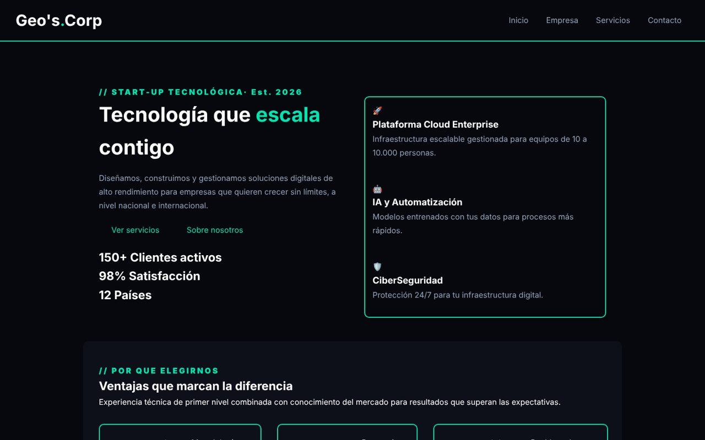

<div align="center">

# ⚡ Geo's Corp — Web corporativa

**Sitio web multipágina para una start-up tecnológica ficticia (cloud, IA y ciberseguridad), maquetado a mano con HTML5 semántico y CSS3.**


<sub>Proyecto de 1º ASIR · 2.º trimestre · Lenguajes de Marcas</sub>



</div>

## 📌 Qué es

La web de presentación de una empresa de servicios IT: portada con propuesta de valor, servicios (Cloud Enterprise, IA y automatización, ciberseguridad), página de empresa con valores, y contacto con oficinas, horario y preguntas frecuentes.

## 🛠️ Cómo está hecha

- **HTML5 semántico** (`header`, `nav`, `main`, `section`, `footer`) en 4 páginas enlazadas.
- **CSS por página** (`styles/empresa.css`, `servicios.css`, `contacto.css`) sobre una hoja global.
- Estética oscura con acento verde neón, tarjetas con borde y diseño **responsive**.

## 📁 Estructura

```
├── index.html            # Inicio
├── routes/
│   ├── empresa.html
│   ├── servicios.html
│   └── contacto.html
├── styles.css            # Estilos globales
└── styles/               # Estilos por página
```

## 🚀 Verla

Clona el repo y abre `index.html`, o actívalo con **GitHub Pages** (rama `main`, carpeta raíz).

---

<div align="center"><sub>Hecho por <a href="https://github.com/RUYA237">Raúl Yagüe</a></sub></div>
